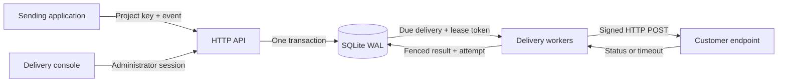

# Architecture

Relay uses a transactional queue in SQLite. This keeps a small installation to one service and one persistent database, with an explicit single-host boundary.

## Acceptance

An event is immutable. The API canonicalizes its data and inserts the event together with one delivery per currently enabled endpoint. HTTP 202 is returned only after commit. If no endpoints are enabled, the event is retained with zero deliveries; later endpoint creation does not backfill it.

An idempotency key is unique within a project. The same type and canonical data return the original event. Different content with the same key is rejected. Idempotency records remain as long as their events remain.

SQLite runs in WAL mode with `synchronous=FULL`, foreign keys enabled, and a ten-second busy timeout. These settings depend on the storage device honoring flush requests. They do not replace backups.

## Claims and leases

Each worker opens a short `BEGIN IMMEDIATE` transaction to select an eligible project and endpoint, then claim one due row through endpoint-scoped indexes. Persisted last-claim times provide fair selection across projects and destinations. Unexpired processing leases enforce one active request per endpoint and two per project by default, including across worker processes. Parked deliveries do not need to be scanned to find work for another endpoint. The claim receives an unpredictable lease token and a 30-second expiration. The endpoint's next available request slot is reserved in the same transaction.

Network I/O happens after releasing the database transaction. Completion starts another transaction and checks that the token still owns an unexpired lease. A stale worker cannot overwrite a newer worker's result.

If the process dies, the row remains in `processing` until its lease expires. Another worker can reclaim it. Only completed results appear as attempt-history records; a process death can leave an unrecorded HTTP attempt. The receiver may have processed that attempt, so deduplication remains necessary.

## Delivery and retries

The worker signs the entire JSON envelope, including event ID, type, creation time, and data. The raw serialized bytes are signed and then sent unchanged. `webhook-type` is a convenience header; receivers should use the authenticated type in the body.

| Result | Action |
| --- | --- |
| HTTP 2xx | Mark delivered |
| Network error, timeout, HTTP 408/429/5xx | Retry if the cycle has attempts remaining |
| Other HTTP status, including redirects | Mark failed |
| Destination rejected by the network policy | Mark failed with a specific reason; do not retry |
| Sixth unsuccessful attempt in a cycle | Mark failed |

Backoff starts at two seconds, doubles per attempt, and adds 25% jitter. `Retry-After` can lengthen the delay, bounded at one hour, including arbitrarily long numeric values. Unexpected delivery exceptions are recorded as failed attempts and consume the retry budget.

The total network attempt deadline is ten seconds, including DNS. Connection establishment and TLS handshakes have a shorter three-second budget within that deadline. A final HTTP 2xx response acknowledges delivery without requiring its body. Error-response excerpts are optional diagnostics capped at 4 KiB and a short read budget; a slow or malformed body does not erase an already received status. Three consecutive timeouts place the endpoint in a persisted 30-second cooldown. A subsequent non-timeout response clears the consecutive-timeout count.

Delivery uses the Standard Webhooks signing format: `webhook-id.timestamp.body`, HMAC-SHA256, a base64-decoded `whsec_` secret, and `v1,<base64 signature>`. The verifier checks a five-minute timestamp tolerance and uses constant-time digest comparison. It accepts multiple `v1` signatures; secret rotation itself is not exposed in this release.

## Replay and endpoint pause

Replay retains the same event ID and completed attempt history, resets the cycle's retry count, and schedules delivery immediately. An active lease blocks replay. Replaying an expired lease invalidates its old token.

Pausing an endpoint stops new claims and excludes it from fanout for newly submitted events. Existing queued work remains and resumes when enabled. An HTTP request already in progress can still finish.

## Network boundary

Every attempt resolves the hostname, checks every returned address, and connects directly to a validated address. The original hostname is retained for TLS verification and the Host header. There is no second lookup in the connection path, and redirects are not followed. Proxy environment variables are not used.

The default policy rejects private, loopback, link-local, site-local, reserved, multicast, and mapped addresses, with explicit checks for special and IPv4-embedding ranges so older Python classification tables cannot silently weaken the boundary. Explicit private-network mode is intended for controlled internal deployments and the loopback demo.

DNS calls run in a bounded pool of daemon threads because OS resolver calls cannot be reliably cancelled. Requests for the same hostname share outstanding resolution work, and failures are cached briefly with bounded memory use. Caller timeout does not release the underlying lookup's capacity until the OS call returns. This prevents one stalled hostname from filling the pool; many distinct stalled names remain a capacity limit.

## Sessions and deployment origins

Browser sessions require both an administrator-token HMAC and a live hashed session record in SQLite. Logout deletes that record; other processes immediately reject a copied cookie. The token signature also invalidates sessions after administrator-token rotation. Sessions expire after eight hours.

When configured, `RELAY_PUBLIC_URL` defines the exact allowed browser origin and HTTPS cookie policy independently of the internal proxy connection. Forwarded headers are not trusted by the CLI. Failed login and bearer authentication share a bounded per-process throttle; valid credentials are checked before applying the failure allowance so anonymous attempts cannot lock out the administrator.

## Boundaries

- A local database on one host; do not place it on a network filesystem or run it as a shared database across hosts.
- One administrator principal per instance. Projects isolate ingestion keys, not administrative users.
- No ordering guarantee, exactly-once business effects, multi-region failover, or uptime commitment.
- Payloads, responses, and signing secrets are stored in the database. Protect the database and backups.
- No automatic payload retention or deletion in v0.1. Monitor disk space and plan retention before sustained use.
- Admission quotas and cluster-wide API rate limiting belong at the reverse proxy in this release. Per-endpoint limits govern outbound delivery.

## Why this design

The database transaction removes a failure gap between saving an event and enqueuing its deliveries. SQLite makes the default installation small and testable while keeping crash recovery explicit. A dedicated database service and distributed queue would be reasonable when write volume or multi-host availability becomes the constraint; that is a separate architecture change, not a configuration claim.
